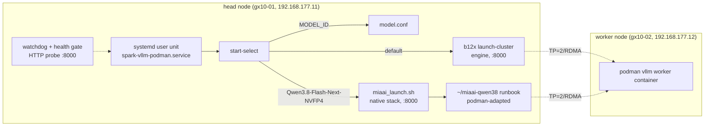

# DGX Spark Dual-Stack Deployment

Two-node NVIDIA DGX Spark cluster (ASUS Ascent GX10, GB10 Superchip, 128 GB
unified memory each) running **two alternative inference stacks** behind one
switch surface, plus the watchdog/supervision that keeps it serving.

| Stack | Model | Engine | Measured decode (t/s) |
|---|---|---|---|
| **b12x** | DeepSeek-V4-Flash-Vision-Exp | `eugr/spark-vllm-docker` launcher, kernel-level b12x/MLAS build (instanttensor, MTP/B12X attention, FP8) | baseline (production default) |
| **MiaAI-native** | nvidia/Qwen3.8-Flash-Next-NVFP4 | `MiaAI-Lab/Qwen3.8-Flash-Next-Dual-DGX-Sparks` stock-vLLM image + overlay patches | **45.5 mean / 68.3 peak** on this kit |

One `vllm-model-set <id> --apply` switches the whole cluster; the wrapper
dispatches each model to its own engine. Watchdog, health gate, selector,
page-cache eviction and `--status` are stack-agnostic and unchanged.

> This repo documents what was done on this cluster and ships the (scrubbed)
> tooling so the setup can be **reproduced from scratch** or borrowed by others.

## Architecture



Fabric: two ConnectX-7 200 GbE ports per node (four logical interfaces when
both are cabled). Both ports are used: 2 × 200 GbE, giving 400 Gb/s aggregate
mesh — see [docs/setup-fresh-install.md](docs/setup-fresh-install.md).

## Repo layout

```
scripts/            deployment + switching + supervision scripts (see below)
config/model.conf.template
config/flags/       per-model flags files (vLLM serve args) + per-model .env
systemd/            user units (podman/health/warmup, optional exporters)
                    + the override.conf that wires start-select
docs/               fresh-install, architecture notes, benchmarking,
                    troubleshooting, observability
dashboards/         Grafana dashboard pack + Home Assistant power alert
tools/              extra tooling (benchmark harness, sweep)
```

### Scripts (installed to `~/.local/bin` by `scripts/deploy.sh`)

| Script | Purpose |
|---|---|
| `spark-vllm-podman-start-select` | systemd ExecStart. Reads `model.conf`, dispatches per model: flash-next → `miaai_launch.sh`; anything else → b12x `launch-cluster.sh` (unchanged path). Also forwards per-model `<flags>.env` vars into the container (`-e`). |
| `miaai_launch.sh` | Native flash-next stack: renders the MiaAI runbook `.env` from `model.conf` + per-model env + fabric constants, runs `start.sh --launch`, keeps the unit alive after readiness. |
| `vllm-model-set` | `vllm-model-set <hf-id> [alias] [--apply]` — the one switch surface. Writes `model.conf`, pauses watchdog, stops unit, **removes both container names (`vllm_node`, `vllm-fn`) on both nodes**, evicts the checkpoint page cache (OOM race), starts, waits for the readiness gate + smoke, restores watchdog. |
| `vllm-model-select.py` / `vllm-model-add.py` | model list / add + lock / delete / `--status` (orchestration state + live engine probe). The selector TUI also does archive/unarchive (`x` / `u`) and archive-path setup (`p`). |
| `vllm-model-archive.py` | checkpoint archive engine behind those keys: `--set-path`, `--status`, `--list`, `--archive`, `--unarchive` (+`--dry-run`, `--json`). Copies a model's cache tree to the archive disk, verifies it file-by-file, frees the internal copy, and refuses an unarchive that would not fit. |
| `vllm-model-select` | Launcher for the selector above: execs `vllm-model-select.py` with the `urwid` venv interpreter (`~/.local/share/vllm-tui/venv`). Must stay a **wrapper** — a symlink to the `.py` resolves to system python and dies on `import urwid`. |
| `setup-tui-venv.sh` | Creates that venv (`urwid==4.2.5`). Called by `deploy.sh`; falls back to `uv` on images without `ensurepip`. |
| `switch.sh` | `switch.sh {status\|list\|to <model-id> [--apply]}` — one obvious command for the daily switch, thin wrapper over the two above. |
| `verify-deployment.sh` | Read-only parity check: repo copy vs installed copy for every artifact, plus wrapper/`urwid`/mods/units/`--status` probes. Exit 0 = in sync. |
| `spark-vllm-watchdog` | loop daemon: probe `/health` + `/v1/models` + completion on `:8000`, re-reading `SERVED_MODEL_NAME` every probe; restarts the unit on failure (backoff 1/5/25/125 min); maintenance flag file `.spark-vllm-maintenance`. |
| `spark-vllm-podman-health` | `ExecStartPost` readiness gate (25 min /health + worker ping). |
| `spark-vllm-podman-stop` | stops b12x cluster **and** removes `vllm-fn` on both nodes. |
| `spark-vllm-evict-cache.py` | release a checkpoint's page cache before load (GB10 unified-memory OOM race). |
| `podman-adapt-runbook.sh` | clones + podman-adapts the MiaAI runbook (`docker`→`podman`); run once on a fresh box. |

`setup-tui-venv.sh` and `verify-deployment.sh` are checkout-only helpers;
everything else above is installed to `~/.local/bin` (and `spark-vllm-warmup.sh`
to `~/`).

## Quickstart (cluster already up)

```bash
# one switch — DeepSeek:
vllm-model-set deepseek-ai/DeepSeek-V4-Flash-Vision-Exp --apply
# one switch — Qwen3.8-Flash-Next native stack:
vllm-model-set nvidia/Qwen3.8-Flash-Next-NVFP4 --apply
# status:
vllm-model-select --status
# parity check (repo vs installed artifacts; read-only):
./scripts/verify-deployment.sh
```

`--apply` does: watchdog pause → stop → remove both stacks' containers (both
nodes) → evict page cache → start (dispatcher picks the engine) → readiness
gate + smoke → watchdog restore. Typical Apply time: 7–13 min.

## Model archive (external disk)

The internal NVMe holds only a couple of checkpoints, so models can be
**archived** to an external ext4 disk instead of deleted: the cached data moves
to `<archive>/models/<name>/`, the profile (flags, alias, lock) stays, and the
model stays listed in the selector — greyed out and not selectable until it is
unarchived. Space is freed as soon as the copy is verified.

```bash
vllm-model-archive --set-path /archive    # once per node (or press p in the TUI)
vllm-model-select                          # x: archive, u: unarchive, p: path
```

Unarchiving is pre-checked against free space on the internal filesystem and
refuses with a list of models to archive first when it would not fit. The model
that is active — the `model.conf` boot default or whatever the engine is serving
— cannot be archived at all: the tool refuses and tells you to switch to another
model/engine first. Setup (mkfs/fstab/ownership), the on-disk layout and the
exact move/verify/delete sequence are in [docs/archive.md](docs/archive.md).

## Fresh install (from scratch)

Full walkthrough in [docs/setup-fresh-install.md](docs/setup-fresh-install.md):
DGX OS notes, ConnectX-7 cabling/IP layout, Docker→Podman (rootless), systemd
user units, both engines' images, weights download with HF token, page-cache
handling, and the dual-stack deploy (`scripts/deploy.sh`).

`deploy.sh` assumes two things beyond this repo, and stops with a clear message
if either is missing:

- **`~/spark-vllm-docker`** — the `kambiz-aghaiepour/spark-vllm-docker` fork
  (supplies `launch-cluster.sh` and `mods/instanttensor-hybrid-draft-loader`).
  Clone it before deploying; `deploy.sh` then installs `mods/busy-loop-fix` there.
  `--skip-mods` installs scripts only.
- **`urwid` for the selector** — `deploy.sh` builds
  `~/.local/share/vllm-tui/venv` via `scripts/setup-tui-venv.sh` and installs
  `vllm-model-select` as a wrapper around `vllm-model-select.py`.

### Runtime parity (repo ↔ live head)

[docs/runtime-parity.md](docs/runtime-parity.md) records the audit against
`gx10-01` (which artifacts were local-only, hashes at audit time) and the
acceptance criteria. Re-check in one command on the head:

```bash
./scripts/verify-deployment.sh   # read-only; exit 0 = repo and install agree
```

### Downloads / HF token

Weights are large (DeepSeek-V4-Flash-Vision-Exp ~176 files; flash-next ~124 GB
NVFP4). Do **not** commit tokens; obtain one at
<https://huggingface.co/settings/tokens> (read scope) and either:

```bash
huggingface-cli login          # stores the token outside the repo
export HF_TOKEN=hf_xxx         # or per-command:
hf download --token "$HF_TOKEN" --repo-type model <model-id> --local-dir ...
```

The repo's scripts never read a token from any file in this tree; they use the
standard `~/.cache/huggingface/token` / `HF_TOKEN` conventions.

## Per-model tuning knobs

`config/flags/<model>.conf` = `vllm serve` args (one per line). Optional
`:parallel `<flags>.env` = environment vars forwarded into the engine
container (e.g. flash-next's `VLLM_TRITON_FORCE_FIRST_CONFIG`). The
flash-next native stack's measured defaults (MTP 3 + expert parallel + FP8 KV
cache, `MM_ENCODER_TP_MODE=data`) live in `miaai_launch.sh` and can be
overridden in that `.env`.

## Results (llama-benchy, identical row: pp=1024, tg=800, depth 0/8192, runs=3)

| Config | Decode t/s | Depth-8192 t/s |
|---|---|---|
| b12x plain (pre-tuning) | 20.0 | 20.4 |
| b12x tuned (MTP/EP etc.) | 26.1 | 26.7 |
| **MiaAI native stack** | **45.5 (peak 68.3)** | **37.8 (peak 57.7)** |

Protocol and notes: [docs/benchmarking.md](docs/benchmarking.md).

## Troubleshooting

See [docs/troubleshooting.md](docs/troubleshooting.md) — FlashInfer autotune
stall (b12x engine, flaky on this kit), `shm_broadcast` warning semantics,
conmon teardown noise, page-cache OOM race, reasoning-model null-content probe
note.

## Model inventory — deployed vs evaluated

### Deployed (what this cluster actually runs)

| Model | Hugging Face URL | Type | Access | Size | Engine stack |
|---|---|---|---|---|---|
| `deepseek-ai/DeepSeek-V4-Flash-Vision-Exp` | https://huggingface.co/deepseek-ai/DeepSeek-V4-Flash-Vision-Exp | Official DeepSeek (open weights) | open | 156.3 GB | b12x |
| `nvidia/Qwen3.8-Flash-Next-NVFP4` | https://huggingface.co/nvidia/Qwen3.8-Flash-Next-NVFP4 | Official Qwen — NVIDIA-published NVFP4 quant; upstream base https://huggingface.co/Qwen/Qwen3.8-Flash-Next | open | 123.6 GB | native (MiaAI) |
| `orcarouter/DeepSeek-V4-Flash-Vision-Uncensored` | https://huggingface.co/orcarouter/DeepSeek-V4-Flash-Vision-Uncensored | Uncensored (abliterated) DeepSeek; base = official V4-Flash-Vision-Exp | **gated** — accept terms, then token | 156.3 GB | b12x |
| `drowzeys/keys-Qwen3.8-Flash-Next-NVFP4-dual-ablit-house-qsa-L3-47` | https://huggingface.co/drowzeys/keys-Qwen3.8-Flash-Next-NVFP4-dual-ablit-house-qsa-L3-47 | Uncensored (abliterated) Qwen; base = `nvidia/Qwen3.8-Flash-Next-NVFP4` | **gated auto** — accept terms, then token | 123.6 GB | native (MiaAI, `ABLIT=1`) |

How each uncensored variant is selected:
- DeepSeek: `vllm-model-set orcarouter/DeepSeek-V4-Flash-Vision-Uncensored --apply`
  (same b12x engine, `flags/deepseek-v4.conf`).
- Qwen: the MiaAI runbook's `ABLIT=1` flow — per-model env
  `flags/drowzeys-…-house-qsa-.env` carries `ABLIT=1`; the runbook downloads
  the gated checkpoint first, then serves it on the native engine.

### Evaluated but NOT deployed

| Model | Why it was not deployed |
|---|---|
| `orcarouter/Qwen3.8-Flash-Next-Uncensored` (+ `-NVFP4` / `-FP8` / `-GGUF` / `-MLX`) | The other uncensored Qwen line. We evaluated it while choosing an uncensored Qwen and selected the drowzeys `ABLIT=1` checkpoint instead — the MiaAI runbook targets it natively. Never pulled or served here. Links: https://huggingface.co/orcarouter/Qwen3.8-Flash-Next-Uncensored |
| `orcarouter/DeepSeek-V4-Flash-Vision-Uncensored-MLX` / `-GGUF` | Format variants of the uncensored DeepSeek we *do* run — other runtimes (MLX/llama.cpp), not our engine. |
| `deepseek-ai/DeepSeek-V4.1-Flash` | Official V4.1 — **510 GB FP8; cannot fit** 2×128 GB unified memory (the evaluated V4.1 uncensored shares this problem in vLLM form). https://huggingface.co/deepseek-ai/DeepSeek-V4.1-Flash |
| `orcarouter/DeepSeek-V4.1-Flash-Uncensored-MLX` | V4.1 uncensored — MLX-only (Apple Silicon), 0 downloads, no vLLM/transformers build → not runnable on this cluster. |
| `Qwen/Qwen3.8-27B` | Flags profile exists on the node only; weights never downloaded (profile-only). |
| (`nvidia-MiniMax-M3-NVFP4`) | Local config only; never registered on the cluster. |

### About the `red-teaming` / `ai-red-team` tags

Abliterated ("uncensored") checkpoints are published with HF card tags such as
**`ai-red-team`** and **`red-teaming`** to signal intended use: adversarial
evaluation of refusal behavior and research. These are **publisher-added
metadata** — visible as tag chips on the model's HF page (e.g. the
`drowzeys/keys-…L3-47` card and the `orcarouter/…-Uncensored` card) and in the
model API's `tags` field. Treat them as a purpose signal, not a classification
by this project. **These variants are provided for research and educational
purposes; users are responsible for lawful use and the upstream terms of the
base models.**

Getting either uncensored model: **accept the repository terms on the HF page
first** (click *"Agree and access repository"*), then provide a token (read
scope — `huggingface-cli login` or `HF_TOKEN`). If a gated download 403s
despite granted access, use `HF_HUB_DISABLE_XET=1` (Xet storage auth issue —
see troubleshooting §8).

## Machine-state files (not versioned)

`locked.conf` (model registry), the live `~/.config/spark-vllm/model.conf`,
`model.conf.bak` (backup written by `vllm-model-set`) and
`~/.config/spark-vllm-watchdog.conf` are per-cluster state — **intentionally
not in this repo**. The templates and defaults live under `config/`; scripts
(notably `vllm-model-set`) manage the live files. `deploy.sh` therefore never
overwrites an existing `model.conf` (use `--force-config` to reset it).

Also not tracked: `~/spark-vllm-docker` (separate fork), `~/miaai-qwen38`
(produced by `podman-adapt-runbook.sh`), `~/.local/share/vllm-tui/venv`
(selector tooling) and `~/.config/spark-vllm/archive.conf` (per-node archive
path). Archived checkpoints live on the external disk, not in the repo. Full
list in [docs/runtime-parity.md](docs/runtime-parity.md).

## Monitoring & alerting

The cluster also runs `node-exporter` + `nvidia-gpu-exporter` user units, a
Grafana dashboard pack, and a Home-Assistant power alert — see
[docs/observability.md](docs/observability.md) (units packaged under `systemd/`,
dashboards under `dashboards/`; Prometheus/Grafana/Home Assistant themselves
are out of scope and referenced only).

## References (credit)

- **DeepSeek / b12x stack** (the standard DeepSeek deployment repo we used):
  - **`kambiz-aghaiepour/spark-vllm-docker`** — **our fork** of eugr's launcher,
    which we use for the cluster (<https://github.com/kambiz-aghaiepour/spark-vllm-docker>).
    Podman patches applied: **PR [eugr/spark-vllm-docker#131](https://github.com/eugr/spark-vllm-docker/pull/131)
    *"Add podman support via CONTAINER_RT environment variable"* by
    **Sebastian Jug ([sjug](https://github.com/sjug))** — commit `55cb129`;
    the launcher therefore runs under rootless podman (upstream defaults to
    docker). Applied vLLM PR patches (per fork README):
    **`local-inference-lab/vllm#669`** (*"Preserve aligned hybrid cache reuse
    alongside endpoint checkpoints"*, by **logprobz** — full-PR-URL launch-time
    patches) and the NCCL load-order fix tracked in
    **`vllm-project/vllm#42354`** (open issue, `mods/use-official-vllm`).
  - **Upstream (credit): `eugr/spark-vllm-docker`** — the repo this was forked
    from (<https://github.com/eugr/spark-vllm-docker>). For a vanilla (docker)
    deployment, use upstream directly.
  - `christopherowen/spark-vllm-mxfp4-docker` — Dockerfile lineage; vLLM /
    FlashInfer / CUTLASS forks. Our image pins `christopherowen/vllm@045293d`
    (<https://github.com/christopherowen/spark-vllm-mxfp4-docker>)
  - b12x engine fork by Luke Alonso (`local-inference-lab/vllm`,
    `--exp-b12x` per eugr README), plus `nvcr.io/nvidia/pytorch` NGC base image
- **Qwen3.8-Flash-Next stack**:
  - `MiaAI-Lab/Qwen3.8-Flash-Next-Dual-DGX-Sparks` — runbook, image
    `vllm/vllm-openai:qwen38-flash-next`, overlay patches, 47k draft vocab
    (<https://github.com/MiaAI-Lab/Qwen3.8-Flash-Next-Dual-DGX-Sparks>)
- **Hardware / cluster docs**: NVIDIA DGX Spark clustering
  (<https://docs.nvidia.com/dgx/dgx-spark/spark-clustering.html>) and
  Connect-Two-Sparks (<https://build.nvidia.com/spark/connect-two-sparks/stacked-sparks>)

## License / attribution

AGPL-3.0. The MiaAI-side launcher adaptation and the runbook invocation derive
from the AGPL-3.0 `MiaAI-Lab/Qwen3.8-Flash-Next-Dual-DGX-Sparks` repo (kept as
a separate clone at runtime, not vendored). See `NOTICE.md`. Internal use only
unless upstream terms are satisfied.

## Security

- Nothing in this tree contains credentials (verified by scrub; tokens stay in
  `~/.cache/huggingface` / env vars).
- The systemd session unit and rootless podman run as a normal user; no
  privilege escalation beyond what `podman`/`systemd --user` grant.
- `start.sh` renders transient launch scripts with mode 0600 (API keys never
  left on disk in the runbook's /tmp).
